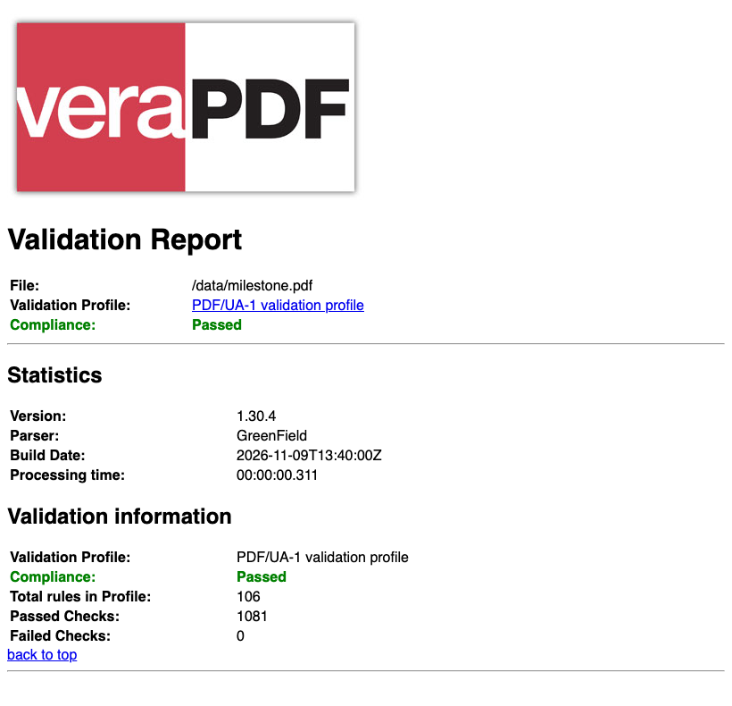

# react-tagged-pdf

Render React components to **tagged PDF** in Node: every heading, paragraph, list, link, image and table
becomes an element in the PDF structure tree, so screen readers and other assistive technology can read the
document in order and with its meaning.

Output passes the [veraPDF](https://verapdf.org) **PDF/UA-1** machine checks. That is all it claims (see
[What you're still responsible for](#what-youre-still-responsible-for)).

> Status: v0.0.1, early. The API may change before 1.0.

## 30-second example

```bash
npm install react-tagged-pdf react@~19.3.0
npm install --save-dev tsx
npm pkg set type=module
echo '{ "compilerOptions": { "jsx": "react-jsx" } }' > tsconfig.json
```

Save as `report.tsx`:

```tsx
import { Document, H1, H2, Link, List, ListItem, P, Page, Table, TD, TH, TR, renderToFile } from 'react-tagged-pdf';

await renderToFile(
  <Document title="Quarterly report" lang="en-US">
    <Page>
      <H1>Quarterly report</H1>
      <P>
        Sales grew this quarter. Read the <Link href="https://example.com/methodology">full methodology</Link> for
        details.
      </P>
      <H2>Highlights</H2>
      <List>
        <ListItem>Sales rose in every quarter.</ListItem>
        <ListItem>Two new regions opened.</ListItem>
      </List>
      <H2>Sales by region</H2>
      <Table>
        <TR>
          <TH>Region</TH>
          <TH>Sales</TH>
        </TR>
        <TR>
          <TD>North</TD>
          <TD>120</TD>
        </TR>
      </Table>
    </Page>
  </Document>,
  'report.pdf',
);
```

```bash
npx tsx report.tsx   # writes report.pdf
```

The package is ESM-only, and the example uses top-level `await`, hence `"type": "module"`.
`renderToBuffer(element)` returns the PDF as a `Buffer` instead of writing a file.

Images need either alt text or an explicit `decorative` flag:

```tsx
<Image src="chart.png" alt="Bar chart: sales rose in each of the four quarters." />
<Image src="divider.jpg" decorative />
```

## Validated with veraPDF



This is veraPDF 1.30.4's own HTML report for [`test/fixtures/milestone.tsx`](test/fixtures/milestone.tsx)
(the example above plus a described image and one more table row). It was produced by rendering the fixture with `npm run test:ua`,
then running
`docker run --rm -v "$PWD/test-output/ua":/data verapdf/cli:v1.30.4 -f ua1 --format html milestone.pdf > report.html`
and capturing `report.html` with headless Chrome (`--screenshot --window-size=820,790`).

Every fixture in `test/fixtures/` is validated against the PDF/UA-1 profile in CI. To run the checks yourself
(Docker required):

```bash
npm run test:ua
```

## Components

| Component | Tag | Notes |
|---|---|---|
| `Document` | `Document` | `title` and `lang` are required; the title is shown in the viewer's title bar. |
| `Page` | | `size` (`A4`, `Letter`, …, or `[w, h]` in points), `margin`, `header`/`footer` (drawn as artifacts). Content flows onto new pages. |
| `PageBreak` | | Starts a new page. |
| `H1`–`H6` | `H1`–`H6` | Start at `H1` and don't skip levels: a skipped level fails PDF/UA-1, and rendering warns about it. |
| `P`, `Section` | `P`, `Sect` | |
| `Span` | `Span` | Inline styling; `lang` marks a language change. |
| `Link` | `Link` | `http`, `https`, `mailto`, `tel`. Underlined by default. |
| `List`, `ListItem` | `L` > `LI` > `Lbl` + `LBody` | `ordered` for numbers. Nested lists work. |
| `Image` | `Figure` | `alt`, or `decorative` to leave it out of the tree. PNG and JPEG. |
| `Table`, `TR`, `TH`, `TD` | `Table` > `TR` > `TH`/`TD` | `TH` gets a `Scope` (Column or Row) automatically, or set `scope`. Long tables break between rows across pages (header rows are not repeated yet). |
| `Artifact` | | Decorative content that screen readers skip. |

Text uses the bundled **Noto Sans** (Latin, Greek, Cyrillic). For other scripts, register a TTF/OTF font with
`Font.register({ family, src, weight, style })` and set `style.fontFamily`. Fonts are always embedded, as
PDF/UA-1 requires.

### Warnings and strict mode

Problems the library can detect, such as a skipped heading level, a table without `TH` cells or an image with
an empty `alt`, are printed as warnings with a stable code and the component's path. Pass `{ strict: true }`
to `renderToBuffer`/`renderToFile` to reject with an `AccessibilityError` instead, which is useful in CI.

Input that cannot be rendered at all, such as an `<Image>` with neither `alt` nor `decorative`, a `<TR>` outside
a `<Table>` or an unknown `style` key, always throws a `ValidationError`, strict mode or not. Like warnings, it
has a stable `err.code` (e.g. `RTP_IMAGE_NO_ALT`) and, where known, the component's path in `err.path`
(e.g. `Document > Page[1] > Section > Image`), so you can tell errors apart without matching on messages:

```tsx
import { renderToBuffer, ValidationError } from 'react-tagged-pdf';

try {
  await renderToBuffer(doc);
} catch (err) {
  if (err instanceof ValidationError && err.code === 'RTP_IMAGE_NO_ALT') console.error(`Describe the image at ${err.path}`);
  else throw err;
}
```

Every code is listed in the `ValidationCode` type.

## How it works

A tagged PDF carries a structure tree alongside what's drawn on the page: it tells a screen reader that this
text is a heading, that one is a list item, and this image is a figure with a description. react-tagged-pdf is
built around that tree. Components are semantic (`H1`, `P`, `List`, `Table`, `Image`), each one maps to a PDF
structure element, and rendering uses upstream [PDFKit](https://pdfkit.org)'s tagged-PDF support. Anything drawn
that isn't content (borders, backgrounds, running headers) is marked as an artifact, so assistive technology
skips it.

## What you're still responsible for

Passing veraPDF's PDF/UA-1 checks means the file is technically well formed: it has a structure tree, a
language, a title, embedded fonts, alt text on figures, tagged links and no untagged content. It does **not**
mean the document is accessible, and it is not a claim of compliance with any law or guideline. Machine checks
cannot judge:

- whether alt text actually describes the image, and whether an image marked `decorative` really is;
- whether the reading order and heading outline make sense to someone who can't see the page;
- whether link text makes sense out of context;
- whether table headers are the right cells, and whether complex tables are understandable;
- colour contrast, text size and whether meaning is conveyed by colour alone;
- whether the document's `lang` and in-text language changes are correct.

Test with a screen reader and, where it matters, have people with disabilities review the result.

## Requirements

- Node.js 20.19 or later (CI runs the tests on Node 22 and 24, and a packed-tarball smoke test on Node 20.19).
- React `~19.3.0` (peer dependency; `react-reconciler` is pinned to the matching release).
- ESM only.

## License

MIT. The bundled Noto Sans fonts are © The Noto Project Authors, under the SIL Open Font License 1.1
([`fonts/OFL.txt`](fonts/OFL.txt)).
